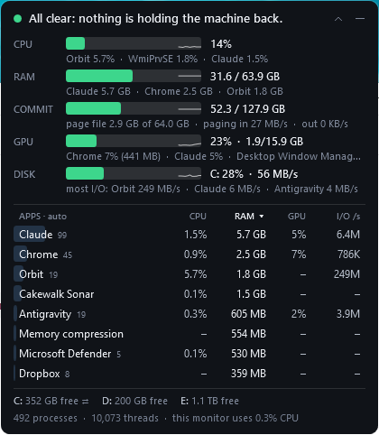

# PerfWidget

An always-on-top Windows widget that answers "what is tanking my machine?" at the level of **apps**, not processes.



## What it shows

- **Headline verdict.** One line naming the current bottleneck and who's causing it, e.g.
  *"CPU maxed at 100%. Blender 61%, Unreal Engine 30%"*, *"Out of RAM: swapping 85 MB/s from disk. Claude 12.1 GB"*,
  *"C: only 6 GB free: the page file on it can't grow."* Green dot = all clear, amber = warning, red = critical.
  Alerts use a 5-second average so brief spikes don't trigger them.
- **Resource lines** with 60-second sparklines and the top consumers underneath:
  - **CPU**: share of all 32 threads.
  - **RAM**: physical memory in use (standby cache excluded).
  - **COMMIT**: memory reserved against RAM + page file. Also shows page-file usage and paging in/out MB/s. This is where swap pressure shows up.
  - **GPU**: busiest engine % plus VRAM used/total (same counters Task Manager uses).
  - **DISK**: busiest physical disk's active time and throughput.
- **Apps table.** Processes are rolled up by process tree, so Claude's ~100 helper processes are one "Claude" row, and ShaderCompileWorkers count toward Unreal Engine.
  - Auto-sort follows the current bottleneck. Click a column header to pin a sort; click it again for auto.
  - Click a row to expand its processes. Hover for commit, VRAM, cores used and hard page faults/s.
- **Drives**: free space per fixed drive. ⇄ marks the drive holding the page file.

## Grouping rules

- A process belongs to the app that launched it, walking up the parent chain.
- The walk stops at OS launchers (Explorer, services, svchost, terminal windows, interactive shells).
- A known app (Chrome, Blender, Unreal…) launched from another app counts as its own app.
- Generic runtimes (electron, node, python, java) are named after their project folder. For example, `...\Orbit\node_modules\electron\electron.exe` shows as **Orbit**.
- Aliases live in `Collector.cs → BuildAliases()`; add a line to rename or merge an app.

## Notes

- RAM per app = private working set (matches Task Manager's Memory column). Commit is in the tooltip.
- Per-app I/O includes file, network and pipe traffic, so it can exceed a disk's own rate.
- Overhead: ~0.15% CPU, ~120 MB RAM (mostly the WPF runtime). No admin rights needed.

## Use

- Drag it by the top half.
- Right-click for compact mode, opacity, always-on-top, start with Windows, rows shown, Task Manager / Resource Monitor, exit.
- `–` hides it to the tray. The tray icon changes colour with the status; click it to bring the widget back.

## Build

```bash
dotnet publish -c Release -o dist -p:PublishSingleFile=true -p:DebugType=none
```

Output: `dist\PerfWidget.exe` (needs the .NET 10 desktop runtime).
`PerfWidget.exe --dump report.txt` writes a text snapshot without opening the UI.

Settings: `%APPDATA%\PerfWidget\settings.json`. Errors: `%APPDATA%\PerfWidget\error.log`.
