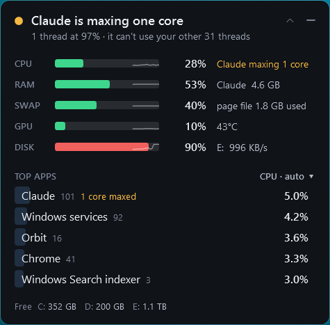

# PerfWidget

An always-on-top Windows widget that answers "what is hammering my machine?" at the level of **apps**, not processes.

 

## Reading it

- **Verdict** (top): one short title plus one line of detail.
  - Green = all clear, amber = warning, red = critical.
  - Up to two more alerts are listed underneath.
  - Alerts use a 5-second average, so brief spikes don't fire them.
- **Five resource lines**: bar with a 60-second sparkline, then %, then the biggest user. Hover any line for the full detail (clocks, temperatures, top 4 apps, page file…).

  | Line | Bar shows | Next to it |
  |------|-----------|------------|
  | CPU  | share of all 32 threads | top app, CPU temp if known; amber "X maxing 1 core" if an app is single-thread bound |
  | RAM  | physical memory in use | biggest app |
  | SWAP | commit (RAM + page file reserved) | page file used, or red "swapping N MB/s" when RAM is full and Windows is paging |
  | GPU  | busiest engine | GPU temperature, top app |
  | DISK | busiest physical disk's active time | that disk and its throughput |

- **Top apps**: one number per app, ranked by whatever is under pressure (CPU when CPU is the problem, RAM otherwise…).
  - Click the ranking label to cycle through CPU / RAM / GPU / I/O / auto.
  - Click an app to see its processes, each with a short description from its command line (`renderer`, `server.js`, `--type=gpu-process`…).
  - Hover a process for its full command line.
- **Free space** per drive at the bottom.

## What it detects

- CPU maxed, RAM full, swapping, virtual memory exhaustion, GPU maxed, VRAM full, disk saturated, low disk space (critical when it's the page-file drive).
- **One app stuck on a single core**: one thread pinned at ≥90% of a core for 5 s. Total CPU looks low in this case, so Task Manager hides it.
- **CPU throttling**: firmware capping clocks (thermal or power), or running below base clock under load.
- **CPU temperature**: ≥ 89°C. Needs LibreHardwareMonitor running (see below).
- **GPU throttling**: NVIDIA thermal / hardware slowdown / power-brake reasons. The routine "power limit" and "reliability" limits are ignored.
- **GPU hot**: within 3°C of its slowdown temperature.
- **Memory creep**: an app that grew ≥ 1.5 GB over 30–60 min and is still at its peak (leak or runaway cache).

## History

- Every 10 s a JSON line goes to `%APPDATA%\PerfWidget\history\yyyy-MM-dd.jsonl` (kept 7 days, ~11 MB/day).
- Each line holds averages and peaks, the apps that mattered in that window, and any alerts.
- Right-click → **What happened in the last hour / 24 hours** opens a digest:
  - peaks with culprits
  - alerts with time ranges
  - memory growth per app
  - average CPU per app
  - lowest CPU clock under load
- Same digest from the command line (this is what Claude can run when you ask what's been slowing the machine):

  ```bash
  PerfWidget.exe --history 60 report.txt
  ```

  `PerfWidget.exe --dump now.txt` writes the live snapshot (every app and its processes) instead.

## Temperatures

- **GPU** (temperature, power, clocks, fan, throttle reasons): read from NVIDIA's NVML, which ships with the driver. No setup needed.
- **CPU**: Windows has no driver-free way to read Ryzen temperatures. Install and run [LibreHardwareMonitor](https://github.com/LibreHardwareMonitor/LibreHardwareMonitor) (it needs admin for its sensor driver). The widget picks up its sensors automatically within a minute.
- **CPU clock speed and firmware throttling** work without it.

## Grouping rules

- A process belongs to the app that launched it, walking up the parent chain.
- The walk stops at OS launchers (Explorer, services, svchost, terminal windows, interactive shells).
- A known app (Chrome, Blender, Unreal…) launched from another app counts as its own app.
- Generic runtimes are named after what they run:
  - `...\Orbit\node_modules\electron\electron.exe` → **Orbit**
  - `node ...\server.js` → **server.js (node)**
  - `python train.py` → **train.py (python)**
- Aliases live in `Collector.cs → BuildAliases()`; add a line to rename or merge an app.

## Notes

- RAM per app = private working set (matches Task Manager's Memory column). Commit is in the tooltip.
- Per-app I/O includes file, network and pipe traffic, so it can exceed a disk's own rate. True per-app disk I/O needs admin ETW tracing.
- Overhead: ~0.12% CPU, ~140 MB RAM (mostly the WPF runtime). No admin rights needed.

## Use

- Drag it by the top half.
- Right-click for:
  - history digests
  - compact mode, opacity, always-on-top
  - start with Windows
  - number of apps shown
  - Task Manager / Resource Monitor, exit
- `–` hides it to the tray. The tray icon is coloured by status; click it to bring the widget back.

## Build

```bash
dotnet publish -c Release -o dist -p:PublishSingleFile=true -p:DebugType=none
```

Output: `dist\PerfWidget.exe` (needs the .NET 10 desktop runtime).
Settings: `%APPDATA%\PerfWidget\settings.json`. Errors: `%APPDATA%\PerfWidget\error.log`.
